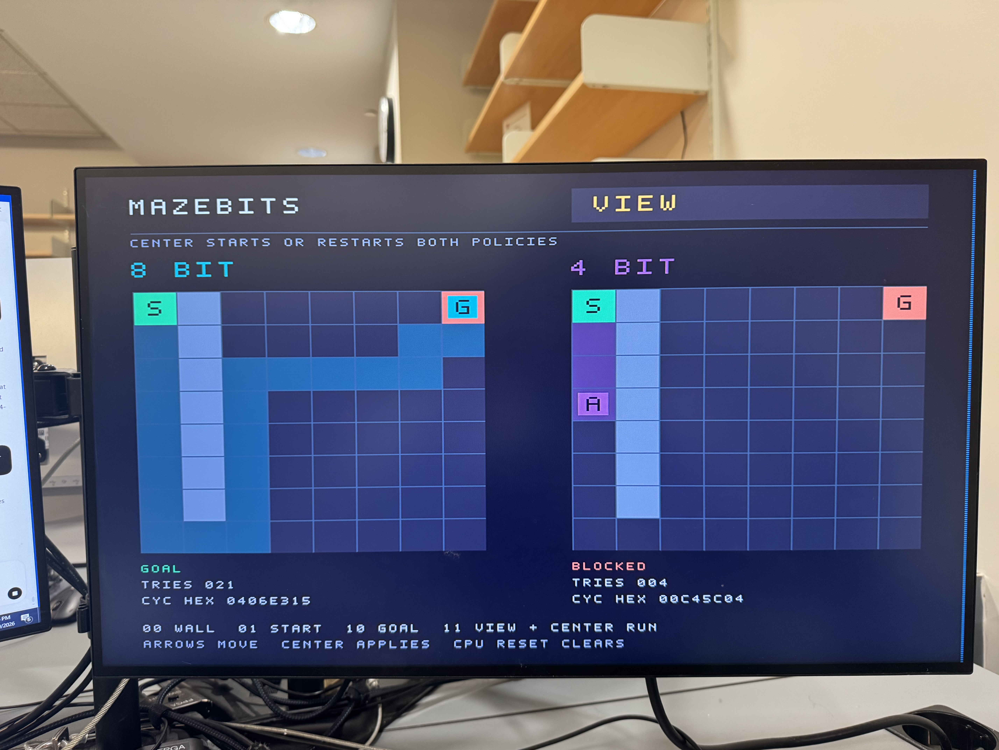
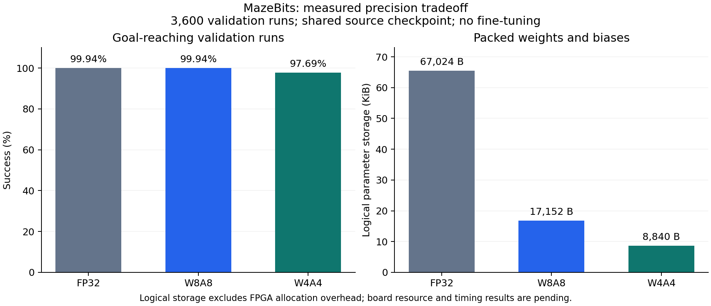

# MazeBits

Interactive FPGA maze navigation with a learned policy, VGA visualization, and an 8-bit versus 4-bit quantization comparison.

MazeBits is an EC311 project for the Nexys A7-100T. The board design lets users edit an 8x8 maze with switches and buttons and compare two quantized neural policies on a VGA display. All three team members collaborate through shared implementation, reviews, and testing.

## Current status

**Step 8 integrates the improved models into the FPGA.** The seven-scenario real dual-CNN simulation passes 157 decisions and 628 exact score comparisons. The user confirmed on the physical board that the new 8-bit policy solves the previously failed 26-move detour; the 4-bit policy still loops there. Open-maze and single-column detour checks also match the new reference; restart, cancellation, and zero-step overlap controls pass. [Step 8](docs/step-08.md) provides the separate bitstream/project paths and physical test instructions. [Verification evidence](results/navigation-structured/README.md) distinguishes simulation, implementation, and physical observations.

**Step 7 improves the base CNN.** With the same architecture and parameter count, structured-maze validation success rises from 76.56% to 99.44% in FP32, from 76.46% to 99.29% at 8 bits, and from 65.75% to 84.38% at 4 bits. Original-layout validation also improves for all three precisions. [Results and known failures](results/policy-improvement/README.md) include paired comparisons and complete traces. [Step 7](docs/step-07.md) explains reproduction. The improved bundles remain separate from the physically tested Step 6 checkpoint below; Step 8 prepares their hardware deployment.

**Step 6 implemented: paired neural navigation and VGA comparison.** Both real CNNs match the Python fixed-point reference over complete maze episodes. The integrated controller and display pass simulation, and a combined FPGA bitstream is generated locally. The user reported that Step 5 passed its physical board test. Step 6 also passes the open-maze and detour board checks: both models reach the open goal in 14 attempts; on the detour, 8-bit reaches the goal in 21 attempts while 4-bit stops blocked after 4. Restart, cancellation, and zero-step start/goal overlap also passed as reported by the user. [The board-test log](results/navigation/board-test.json) separates physical evidence from simulation.

## Original checkpoint: physical maze comparison

Actual VGA monitor photograph supplied after the physical board test. The 8-bit model reaches the goal in 21 attempts; the 4-bit model stops blocked after 4. The [open-maze photograph](results/navigation/hardware/open-maze.jpg) shows both models succeeding in 14 attempts. Published copies preserve the original image pixels and omit camera location metadata.

Arrows move the editor cursor; center applies an edit. SW1:SW0 selects 00=WALL, 01=START, 10=GOAL, or 11=VIEW. In VIEW, press Center to start or restart both models from the same edited scenario. Returning to an edit mode stops both agents and preserves the map. CPU RESET clears the map.

Each panel shows its own agent, trail, outcome, attempted actions (TRIES), and accumulated inference cycles (CYC HEX). Both precisions use the same serial schedule. An intentional 200 ms pause makes movement visible and is excluded from the cycle totals.

| Verified scenario | W8A8 | W4A4 |
|---|---|---|
| Open maze | Goal, 14 attempts | Goal, 14 attempts |
| Detour | Goal, 21 attempts | Blocked, 4 attempts |
| Disconnected goal | Loop, 4 attempts | Loop, 3 attempts |
| Start equals goal | Goal, 0 attempts | Goal, 0 attempts |

~~~powershell
python scripts/run_navigation.py --sim xsim --vivado-bin C:/Xilinx/Vivado/2024.1/bin
python scripts/run_navigation_vivado.py --stage bitstream --vivado C:/Xilinx/Vivado/2024.1/bin/vivado.bat
~~~

Read [Step 6 and board-test instructions](docs/step-06.md), [navigation VGA layout](docs/navigation-vga-layout.md), and [verification/implementation evidence](results/navigation/README.md). The original local bitstream is `runs/vivado/navigation/mazebits_navigation.bit`; its GUI project is `runs/vivado/navigation_gui/mazebits_navigation.xpr`. The improved model uses `runs/vivado/navigation-structured/mazebits_navigation_structured.bit` and `runs/vivado/navigation_structured_gui/mazebits_navigation_structured.xpr`. The editor-only Step 5 version remains available separately.

## Learned policy baseline

Both quantized models retain the same Step 3 checkpoint and train-only calibration.

| Validation result | FP32 | W8A8 | W4A4 |
|---|---:|---:|---:|
| Goal-reaching runs | 3,598 / 3,600 | 3,598 / 3,600 | 3,517 / 3,600 |
| Navigation success | 99.9444% | 99.9444% | 97.6944% |
| Logical parameter bytes | 67,024 | 17,152 | 8,840 |

W4A4 reduces the packed parameter payload by 48.46% relative to W8A8, with a 2.25 percentage-point reduction in navigation success. Routed resource and timing measurements for the minimal board test are below. The test partition is reserved.

## Verilog inference

| Routed board-test metric | W8A8 | W4A4 |
|---|---:|---:|
| LUTs | 496 | 366 |
| Registers | 273 | 258 |
| 36 Kb BRAM tile equivalents | 9 | 5 |
| DSP blocks | 0 | 0 |
| Setup slack (ns) | 1.497 | 1.757 |
| Hold slack (ns) | 0.122 | 0.073 |
| DRC violations | 0 | 0 |
| Cycles per decision | 3,217,153 | 3,217,153 |
| Latency at 100 MHz | 32.17153 ms | 32.17153 ms |

These are measurements for the button/LED wrapper with two fixed fixtures, not the final editable/VGA system. Both builds have zero DRC violations. The serial schedule gives both widths the same latency; this is not a CPU speed comparison.

~~~powershell
python scripts/run_rtl.py --sim xsim --vivado-bin C:/Xilinx/Vivado/2024.1/bin --bits 8 4
python scripts/run_vivado.py --bits 8 4 --stage bitstream --vivado C:/Xilinx/Vivado/2024.1/bin/vivado.bat
~~~

The HDL runners need only standard-library Python. Icarus Verilog is also supported with --sim iverilog. Read [Step 4](docs/step-04.md), [board controls and constraints](docs/board-constraints.md), and [implementation evidence](results/rtl/README.md).

## Try the precision comparison

Use Python 3.12 and run from the repository root:

~~~powershell
python -m pip install -r requirements.txt
python python/predict_fixed.py --bits 8 --maze detour --trace
python python/predict_fixed.py --bits 4 --maze detour --trace
~~~

The committed memory bundles run immediately; dataset generation and retraining are unnecessary for this demo. On the hand-written detour, W8A8 reaches the goal in 21 moves, while W4A4 hits a wall on attempt four. These commands run CPU integer references for the original checkpoint, whose board demonstration is shown above.

The floating-point baseline remains available:

~~~powershell
python python/predict.py --maze detour --trace
~~~

All policies select their raw argmax action. No BFS route or illegal-action repair assists inference.

## Model and data

The CNN has 16,756 parameters: eight 3x3 convolution/ReLU layers with 16 channels, followed by a 1x1 four-action head. Binary input planes represent walls, current agent position, and goal. The agent's cell selects the four action scores.

Training uses BFS-guided imitation learning. The dataset contains 800 training layouts with 117,171 labeled states, 150 validation layouts with 22,029 states, and 150 reserved test layouts. Rotated and reflected copies cannot cross partitions. All equally optimal shortest-path actions remain valid targets.

W8A8/W4A4 means signed 8/4-bit weights and unsigned 8/4-bit hidden activations. Biases, accumulators, and final scores remain signed 32-bit. Power-of-two scales, ties-away rounding, saturation, and every partial-sum bound are specified in [Step 3](docs/step-03.md).

## Verification

The latest software-test record is in [Step 8 evidence](results/navigation-structured/README.md). Step 6 checks 60 complete-loop decisions, 240 signed scores, 202 controller checks, 34 integrated control checks, and three full VGA frames. For the original Step 3/4 numerical verification, for each precision:

- 133,160 intermediate/output words matched independent scalar arithmetic across eight fixtures.
- Fresh-process replay matched all 88,116 validation score words and 3,600 trajectories.
- Exported memory files, headers, tensor layouts, and hashes were checked.

~~~powershell
python -m unittest discover -s python/tests -v
python python/verify_fixed_vectors.py --model-dir model/cnn-w8a8 --vectors-dir test_vectors/cnn-w8a8
python python/verify_fixed_vectors.py --model-dir model/cnn-w4a4 --vectors-dir test_vectors/cnn-w4a4
~~~

GitHub Actions runs the unit tests, Python vector replays and RTL-vector suites for both original and improved checkpoints in Icarus Verilog, the board-control tests, the editor/VGA suites, and the navigation-control and original/improved real dual-CNN suites. A full validation replay additionally needs the generated dataset:

~~~powershell
python python/prepare_data.py --output-dir data/maze-v1
python python/verify_fixed_point.py --output-dir runs/recheck-fixed
~~~

Reuse an existing dataset. Generated output directories must be new or empty.

## Documentation

- [Project proposal](docs/proposal.md): application, demonstration, and shared milestones.
- [Step 1](docs/step-01.md): maze movement, BFS, and input encoding.
- [Step 2](docs/step-02.md): dataset, CNN training, and floating-point results.
- [Step 3](docs/step-03.md): integer arithmetic, calibration, exports, and comparison.
- [Step 4](docs/step-04.md): Verilog datapath, interfaces, cycle counts, HDL verification, and routed builds.
- [Step 5](docs/step-05.md): board-tested controls, editable map, and VGA display.
- [Step 6](docs/step-06.md): independent neural navigation, path comparison, and board-test instructions.
- [Step 7](docs/step-07.md): structured-maze training, improved FP32/integer candidates, and fair validation comparisons.
- [Step 8](docs/step-08.md): improved-weight RTL verification, separate FPGA build, and board checks.
- [Dataset audit](results/dataset/README.md) and [training evidence](results/cnn-baseline/README.md).
- [Quantization evidence](results/quantization/README.md).
- [Benchmarking guide](docs/benchmarking.md): inference time, packed storage, routed resources, and paired navigation quality.
- [W8A8 bundle](model/cnn-w8a8/README.md) and [W4A4 bundle](model/cnn-w4a4/README.md).
- [W8A8 RTL vectors](test_vectors/cnn-w8a8/README.md) and [W4A4 RTL vectors](test_vectors/cnn-w4a4/README.md).

## Next checkpoint

Step 6's physical checklist is complete. Step 8 verifies the improved integer models in RTL and prepares a separate VGA navigation bitstream. Its three maze board checks and all three final control checks pass, as reported by the user. The improved checkpoint is ready for final held-out evaluation and project reporting; reserved-test results have not yet been measured. Each milestone is committed and pushed on its own branch.
