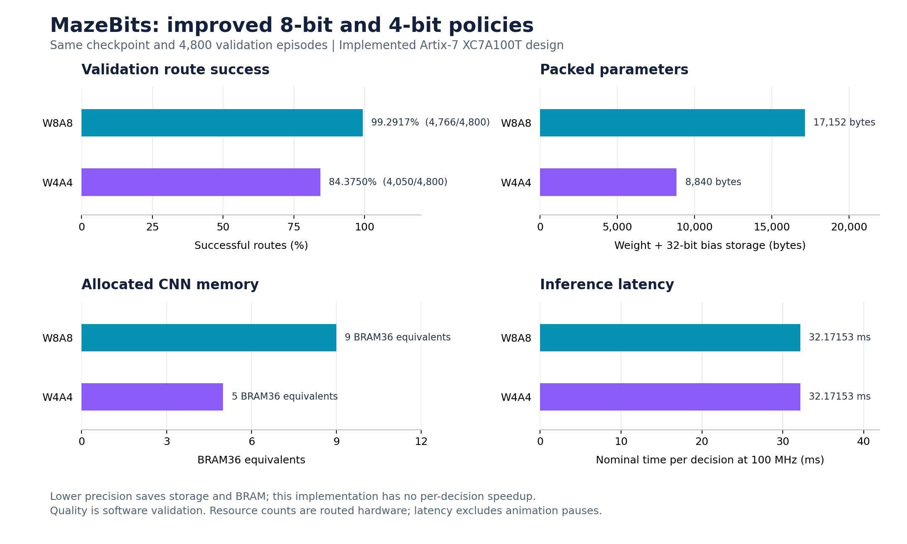

EC311 / MAZEBITS / EVALUATION REPORT

# MazeBits quantization evaluation

Improved CNN: W8A8 versus W4A4 | November 19, 2026

4-bit saves memory. 8-bit provides more reliable navigation on structured mazes.

On the same 4,800 validation routes, W8A8 reaches the goal in 99.29% of runs and W4A4 in 84.38%. W4A4 uses 48.46% fewer packed parameter bytes and 44.44% fewer CNN BRAM equivalents. Both engines take 32.17153 ms per decision at the implemented 100 MHz clock constraint.

Figure 1. Same improved checkpoint, two precisions. Quality is measured in the Python integer reference on validation data; resources come from routed Vivado hierarchy reports; latency comes from verified cycles at the routed clock constraint. Sources S1-S3.

### Main finding

The 4-bit route-success reduction is **14.92 percentage points**, or 716 fewer successes overall. The current serial engine has **no per-decision speedup** at 4 bits. This implementation demonstrates a storage/resource versus navigation-quality tradeoff.

Physical board tests confirm the improved 8-bit policy solves the previously failed 26-move detour. The 4-bit policy still loops on that map. All six required board checks pass by user report. These examples corroborate implementation behavior; aggregate accuracy comes from the validation set. [S4]

## 1. Navigation performance

Both models use identical layouts, starts, goals, action order, and termination rules. Actions are raw argmax outputs. No BFS planner, invalid-action repair, or visited-cell avoidance assists inference. BFS supplies labels and reference path lengths. [S2, S5]

| Metric / same 4,800 routes | W8A8 | W4A4 |
| --- | --- | --- |
| Goal-reaching routes | 4,766/4,800 | 4,050/4,800 |
| Route success | 99.29% | 84.38% |
| Optimal-action accuracy / 27,084 states | 99.75% | 97.54% |
| Blocked / loop / timeout | 0 / 34 / 0 | 37 / 713 / 0 |
| Mean successful path length / BFS optimum | 1.00018 | 1.00290 |

The FP32 source succeeds on 4,773/4,800 routes (99.44%). The 8-bit result is close to that source; most additional failures occur at 4 bits. Optimal-action accuracy counts any equally shortest action as correct. A single poor action can end a route, so high one-step accuracy does not guarantee high route success. Path ratios exclude failures: their denominators are 4,766 and 4,050 successful runs, respectively. Read them alongside success counts.

### Paired outcomes

| Both succeed | Only 8-bit succeeds | Only 4-bit succeeds | Both fail |
| --- | --- | --- | --- |
| 4,040 | 726 | 10 | 24 |

The 10 routes solved only by W4A4 show that higher precision does not win on every individual maze. Quantization changes score rankings and can occasionally improve a particular trajectory. The aggregate favors W8A8.

### Where the gap appears

| Validation subgroup | Routes | W8A8 success | W4A4 success |
| --- | --- | --- | --- |
| Connected barriers | 960 | 98.65% | 90.83% |
| Random obstacles | 1,920 | 99.90% | 95.94% |
| Winding corridors | 1,920 | 99.01% | 69.58% |
| BFS distance 0-9 | 2,726 | 100.00% | 96.70% |
| BFS distance 10-19 | 1,595 | 99.12% | 78.43% |
| BFS distance 20+ | 479 | 95.82% | 34.03% |

Family groups and distance groups are two views of the same 4,800 routes; do not add their denominators together. Layouts contribute 24 routes each, so episode outcomes are correlated. These are descriptive validation results, with no independent-episode confidence interval claimed.

## 2. Runtime and memory

### Timing measures equal work

**Latency = 3,217,153 cycles / 100,000,000 Hz = 32.17153 ms per decision.** Both precisions use the same serial schedule. Width reduction changes storage and logic size but not the number of scheduled operations. [S1, S3]

The displayed CYC HEX accumulates CNN cycles. It excludes the intentional 200 ms animation pause after nonterminal moves, button handling, VGA refresh, and other controller overhead. Fourteen decisions require 45,040,142 cycles, or 450.40142 ms of inference, for either model. Visible animation lasts longer.

On the same 4,040 routes where both models succeed, mean inference-only route time is 267.29445 ms at 8 bits and 267.97929 ms at 4 bits. Their paths have equal length in 4,000 cases; W8A8 is shorter in 40, with 86 extra W4A4 moves overall. This paired comparison avoids treating early failures as faster solutions.

| Storage / routed CNN metric | W8A8 | W4A4 |
| --- | --- | --- |
| Packed weights / 16,624 values | 16,624 bytes | 8,312 bytes |
| Packed biases / 132 signed 32-bit values | 528 bytes | 528 bytes |
| Total packed parameters | 17,152 bytes | 8,840 bytes |
| Two logical activation banks | 2,048 bytes | 1,024 bytes |
| BRAM36 equivalents | 9 | 5 |
| LUTs | 632 | 524 |
| Registers | 347 | 333 |
| DSP blocks | 0 | 0 |

W4A4 saves 48.46% of packed parameter storage, 44.44% of CNN BRAM allocation, and 17.09% of CNN LUTs in this combined routed design. Its nominal speedup is 1.00x. Biases remain 32-bit, so total parameter storage does not halve exactly.

### Payload, working memory, and physical allocation

Packed parameter bytes describe the binary model payload. Activation-bank bytes describe intermediate tensors only. They exclude score accumulators, inputs, control registers, and memory-allocation overhead. BRAM equivalents describe the physical blocks allocated by Vivado: the 8-bit core uses eight RAMB36 plus two RAMB18 blocks; the 4-bit core uses four RAMB36 plus two RAMB18 blocks.

ASCII .mem file size and full .bit file size are unsuitable measures of model storage. The bitstream also configures routing and the rest of the device. Zero DSP blocks means synthesis implements arithmetic in logic; multiplication still occurs.

### Whole-design timing closure

The combined two-engine VGA/navigation build uses **2,176 LUTs, 1,695 registers, 14.5 BRAM36 equivalents, and 0 DSP blocks**. At a 10 ns clock constraint, routed setup slack is +0.603 ns and hold slack is +0.042 ns, with zero DRC violations. Per-CNN counts above exclude surrounding logic; hierarchy attribution can depend on synthesis optimization. [S3]

These are implemented-design results and nominal cycle-derived timing. They are not an independent oscillator-frequency measurement, energy measurement, or speed comparison against optimized CPU inference. A failed route that stops earlier is not faster successful navigation.

## 3. FPGA verification and board results

The improved integer models were verified before programming. The final bitstream was built from the same generated CNN HDL and memory-initialization bytes as the passing navigation simulation, checked again after staging integrity hardening. [S6, S7]

| Verification layer | Recorded coverage |
| --- | --- |
| Python tests | 153 passed |
| Each CNN RTL core | 8 fixtures; 133,160 intermediate/output words; repeat and protocol checks |
| Arithmetic edge cases, per core | 13 rounding cases; 3 signed/tie argmax cases |
| Complete dual-CNN navigation | 7 scenarios; 14 episodes; 157 decisions; 628 exact signed-score matches |
| Controls and VGA | 202 controller checks; 34 integrated checks; 3 complete VGA frames |
| Original-checkpoint regression | 4 scenarios; 8 episodes; 60 decisions; 240 scores |

### User-reported tests on the improved bitstream

| Physical maze | W8A8 | W4A4 |
| --- | --- | --- |
| Open maze | GOAL / 014 | GOAL / 014 |
| Single-column detour | GOAL / 021 | LOOP / 008 |
| Previously failed long detour | GOAL / 026 | LOOP / 004 |

Each result includes the expected displayed cycle count: open 02AF420E for both; detour 0406E315 / 0188B808; long detour 04FC561A / 00C45C04. Restart during movement, cancellation on returning to editing, and start equal to goal with zero attempts/cycles also pass. [S4]

The three maze runs and three controls complete the required physical checklist. Other reference layouts have simulation results but remain physically untested. These observations were reported by the user; the improved-build checks have no newly supplied monitor photographs in this record.

### Interpretation

The long-detour result demonstrates that the improved 8-bit model handles a layout the original model failed. The 4-bit loop is consistent with its exact integer reference, rather than an observed arithmetic mismatch in the exercised RTL tests. Full correctness for every possible editable maze is not established by this finite suite.

Known demonstration maps were excluded from generated training splits, including their rotations/reflections. They were nevertheless used during development, so these examples do not provide an unbiased estimate of generalization. The validation suite supplies the broader comparison.

## 4. Methodology, limits, and conclusion

**Controlled comparison.** Both models are post-training quantizations of one improved FP32 checkpoint. Architecture: eight 3x3 convolution/ReLU layers with 16 channels, then a 1x1 four-action head; 16,624 weights and 132 biases. Inputs are three binary 8x8 planes for walls, current agent, and goal. Weights are signed 8/4-bit, hidden activations unsigned 8/4-bit; biases, accumulators, and final scores remain signed 32-bit.

Calibration uses 4,096 training states with seed 312. The structured dataset has 1,200 training layouts, 200 validation layouts, and 200 reserved-test layouts. The main evaluation covers all 27,084 labeled validation states and 4,800 fixed routes. The FP32 checkpoint was selected using this validation set, so these numbers are development estimates. Reserved test sets have not been evaluated. [S2, S5]

**Distribution matters.** On the original random-layout validation distribution, the same improved models score 3,600/3,600 (100.00%) at 8 bits and 3,557/3,600 (98.81%) at 4 bits. The larger gap on the structured distribution shows that one easy-maze score cannot establish robustness across maze types. [S8]

**Conclusion.** Use W8A8 as the current navigation model when route reliability is the priority. Keep W4A4 as the measured resource-saving comparison: it reduces model payload and FPGA memory substantially, while losing reliability most clearly on winding corridors and long routes. The present architecture does not turn the smaller width into lower latency.

**Next evaluation.** Freeze the selected models and evaluate the reserved test partition before making final generalization claims. Further changes to W4A4 should be evaluated with the same paired route protocol and exact RTL checks. Power and optimized CPU latency require separate measurements.

### Evidence and reproduction

[S1] [Matched-checkpoint benchmark](https://github.com/t1sun1012/mazebits-fpga/blob/0bd19baa7dea709d8711b16bfb94b5be9aa4c523/results/navigation-structured/benchmark.json)

[S2] [Integer validation and calibration provenance](https://github.com/t1sun1012/mazebits-fpga/blob/0bd19baa7dea709d8711b16bfb94b5be9aa4c523/results/policy-improvement/quantization/comparison.json)

[S3] [Routed resources, timing, DRC, and build identity](https://github.com/t1sun1012/mazebits-fpga/blob/0bd19baa7dea709d8711b16bfb94b5be9aa4c523/results/navigation-structured/build/implementation.json)

[S4] [Physical board-test observations](https://github.com/t1sun1012/mazebits-fpga/blob/0bd19baa7dea709d8711b16bfb94b5be9aa4c523/results/navigation-structured/board-test.json)

[S5] [Dataset audit and evaluation protocol](https://github.com/t1sun1012/mazebits-fpga/blob/0bd19baa7dea709d8711b16bfb94b5be9aa4c523/results/dataset-v2/README.md)

[S6] [Core and complete-navigation verification](https://github.com/t1sun1012/mazebits-fpga/blob/0bd19baa7dea709d8711b16bfb94b5be9aa4c523/results/navigation-structured/README.md)

[S7] [Final generated-input equivalence](https://github.com/t1sun1012/mazebits-fpga/blob/0bd19baa7dea709d8711b16bfb94b5be9aa4c523/results/navigation-structured/final-stager-equivalence.json)

[S8] [Cross-distribution improvement evidence](https://github.com/t1sun1012/mazebits-fpga/blob/0bd19baa7dea709d8711b16bfb94b5be9aa4c523/results/policy-improvement/README.md)

Evidence snapshot: 0bd19baa7dea. Final bitstream SHA-256: 3aa08afa503ab2ac9856d48f5c5aa702 bbe53fa5b03d158081285be3a606536b. Full hashes, paired counts, subgroup counts, and figure identities are in results/evaluation/metrics.json.

Reproduce from the repository root: run scripts/prepare_evaluation_report.py, then scripts/render_evaluation_report.py. The first uses existing evidence plus validation-layout metadata and matplotlib; the second requires reportlab and pypdf. No retraining, new inference, or reserved-test access is performed to compile this report.
