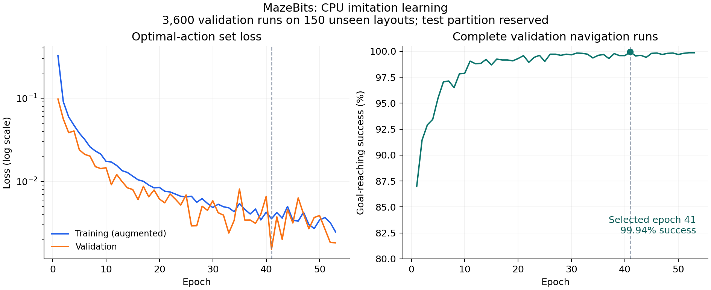

# Step 2: Maze Dataset and CNN Imitation Learning

Step 1 established correct movement rules and a BFS shortest-path reference. This step generates labeled examples, trains a neural policy on the CPU, and evaluates complete navigation runs on unseen validation layouts.

This is imitation learning: BFS supplies examples of good actions. The CNN learns from those examples and later chooses actions from its own scores. No rewards or reinforcement-learning updates are used.

## Reproduce the workflow

Use Python 3.12 and the pinned CPU dependencies. Run from the repository root:

~~~powershell
python -m pip install -r requirements.txt
python python/prepare_data.py --output-dir data/maze-v1
python python/train.py --data-dir data/maze-v1 --run-dir runs/cnn-baseline
~~~

Dataset and training output directories must be new or empty. Reuse an already generated dataset when retraining; choose a new run directory for another experiment.

The published model can be evaluated without retraining:

~~~powershell
python python/evaluate.py --data-dir data/maze-v1 --model-dir model/cnn-fp32 --output-dir runs/recheck-cnn --reference-rollouts results/cnn-baseline/validation_rollouts.json
python python/predict.py --model-dir model/cnn-fp32 --maze detour
python -m unittest discover -s python/tests -v
~~~

To evaluate your own completed training run, replace model/cnn-fp32 with runs/cnn-baseline/model and use that run's validation_rollouts.json as the trajectory reference. The evaluator uses validation data; the test partition remains reserved.

For a custom map, use --maze-file path/to/maze.txt with the eight-row ASCII format from Step 1. The --trace option prints each CNN action and resulting position.

Reproducible replay is scoped to the recorded CPU environment and pinned versions. PyTorch does not guarantee identical training across platforms or releases. The verifier requires the recorded discrete metrics and rollout summaries, allows a loss tolerance of 1e-6 relative / 1e-7 absolute, and checks every trajectory when --reference-rollouts is supplied. See [PyTorch's reproducibility notes](https://docs.pytorch.org/docs/2.9/notes/randomness.html).

## Dataset generation

No external image dataset is needed. We generate 8x8 obstacle layouts using seed 311. For each candidate, the generator selects a wall probability of 10%, 20%, or 30% with equal probability, then independently samples each cell. These are requested probabilities; the actual wall count varies by layout.

The largest connected region of free cells must contain at least 24 cells. Three distinct goals are sampled within that region. For each goal, BFS labels every reachable nonterminal position. All decision examples therefore have a route to their goal.

| Partition | Distinct layouts | Goals | Labeled states | Rollout episodes |
|---|---:|---:|---:|---:|
| Training | 800 | 2,400 | 117,171 | 19,200 |
| Validation | 150 | 450 | 22,029 | 3,600 |
| Reserved test | 150 | 450 | 22,308 | 3,600 |

Each goal has eight fixed rollout starts. These are sampled from bins ordered by BFS distance, so evaluation includes a range of starting distances.

A layout and every rotation or reflection of it share one canonical identifier. Duplicate identifiers are rejected across the entire dataset. All goals and states belonging to a layout stay within its partition. This prevents the model from seeing a rotated copy of a validation or test layout during training.

The generated dataset contains:

- train.npz, val.npz, and test.npz: binary inputs, acceptable-action labels, and state metadata.
- Matching JSON files: layouts, goals, and fixed rollout episodes.
- manifest.json: generation settings, counts, canonical layout IDs, audit information, and file hashes.

Raw generated data stays under the ignored data/ directory. The committed audit manifest is [results/dataset/manifest.json](../results/dataset/manifest.json). Test files are generated and hashed, but the training and validation evaluation code do not load their examples or run model inference on them.

## What one training example means

The input is three 8x8 binary planes in channel-first order:

1. Walls: 1 at obstacles.
2. Agent: 1 at the current position.
3. Goal: 1 at the destination.

The flat ordering is channel * 64 + y * 8 + x. Values remain exact 0 or 1 when converted to floating point; no image normalization is applied.

Each label has four bits in the frozen order UP=0, RIGHT=1, DOWN=2, LEFT=3. A bit is 1 when that action reduces the BFS distance to the goal by one. Several actions may be equally optimal, and all of them remain valid labels. Goal states and unreachable states are excluded from supervised decisions.

## CNN architecture

~~~text
3 x 8 x 8 binary state
    -> 3x3 convolution, 3 -> 16 channels, ReLU
    -> seven 3x3 convolutions, 16 -> 16 channels, ReLU after each
    -> 1x1 convolution, 16 -> 4 action channels
    -> select the four scores at the agent cell
    -> argmax action: up, right, down, or left
~~~

All feature maps retain the 8x8 spatial shape. The first convolution pads the wall channel with 1 to represent obstacles outside the board, and pads the agent and goal channels with 0. Later hidden feature maps use zero padding.

The agent plane is both an input to the convolutions and the selector for the final four scores. There is no fully connected classifier or pooling layer. The final head outputs raw scores; a softmax is unnecessary when choosing their maximum.

The default model has 16,756 parameters: 16,624 weights and 132 biases. A dense computation requires 1,063,936 multiply-accumulate operations per decision, excluding activations and selection logic. This is an arithmetic operation count, not an FPGA cycle count or measured speedup.

Eight 3x3 layers give a 17x17 receptive field, covering the 8x8 input. Coverage alone does not guarantee that the CNN can navigate every obstacle arrangement.

## Training and checkpoint selection

Training uses seed 311, deterministic PyTorch operations, one CPU thread, Adam with a learning rate of 0.001, and batches of 256 states. The maximum is 60 epochs. Training stops early after 12 consecutive epochs without a better checkpoint.

During training, a randomly chosen rotation or reflection is applied to each batch, with matching transformations of the action labels. This D4 augmentation teaches the same movement relationships in different orientations. Validation inputs remain unchanged.

The loss is the negative logarithm of the total probability assigned to all optimal actions. For example, when RIGHT and DOWN are both shortest-path choices, either receives credit. The model is not required to imitate one arbitrary BFS tie-break.

After every epoch, we measure validation decision accuracy and complete validation rollouts. The selected checkpoint has the highest number of successful validation rollouts; equal success counts are broken by lower validation loss. The software target is at least 90% success on these validation episodes. This is a target to measure, not a promised result.

The test partition does not participate in model selection.

## How navigation is evaluated

Each episode starts on its specified layout and uses the same frozen goal. At every decision, the CNN receives the current walls, agent position, and goal. Its raw argmax determines the attempted move.

The evaluator does not mask illegal actions, choose an alternative after a collision, or use BFS to repair a route. It stops on:

- Success: the agent reaches the goal.
- Blocked: the selected move hits a wall or boundary.
- Loop: the agent returns to a previously visited position.
- Timeout: the agent reaches the 64-action limit.

The policy is deterministic and has no hidden state during evaluation, so revisiting the same position on the same map and goal would repeat its behavior. Outcomes remain distinct; a failed rollout does not mean the maze is unsolvable.

We report optimal-action accuracy on individual states, rollout success, failure counts, and successful path length relative to the BFS optimum. A ratio of 1 means an optimal route. Path efficiency is reported only for successful runs. Zero-length successful routes are excluded from the undefined 0/0 ratio. Results also include groups by requested obstacle probability.

## Saved model and evidence

The published floating-point bundle is [model/cnn-fp32](../model/cnn-fp32). It contains weights.npz and a manifest describing tensor shapes, architecture, training provenance, and the weight-file hash. Loading checks the hash, tensor names, dimensions, floating-point dtype, and finite values. It does not require loading a pickle checkpoint.

Training records history.csv, run.json, metrics.json, and validation_rollouts.json. Published evidence is kept in [results/cnn-baseline](../results/cnn-baseline). The local best.pt is an intermediate training checkpoint and is not needed to load the published model.

## Results

The CPU run completed 53 epochs in 671.96 seconds (about 11.2 minutes), stopping after 12 epochs without improving the selection criterion. Epoch 41 was selected.

| Metric | Selected floating-point CNN |
|---|---:|
| Optimal-action accuracy | 22,012 / 22,029 = 99.9228% |
| Goal-reaching validation runs | 3,598 / 3,600 = 99.9444% |
| Blocked / loop / timeout outcomes | 0 / 2 / 0 |
| Successful mean path / BFS optimum | 1.000279 |
| Successful routes that were shortest | 3,593 / 3,598 = 99.8610% |
| Parameters | 16,756 |

The two failures occur on the same validation layout and goal, from starts with BFS distances 14 and 18. Both enter a two-cell loop. Their full inputs and action traces are retained in [failures.json](../results/cnn-baseline/failures.json); [examples/validation-loop.txt](../examples/validation-loop.txt) makes one case easy to replay.

Fresh-process loading reproduced all state metrics exactly and all 3,600 trajectories. The 52 software tests passed. The test partition remains reserved; these are validation results used for checkpoint selection.

Post-training hand-written checks reached the goal in the open maze (14 moves) and the long detour (21 moves), both shortest routes. The disconnected example stopped with a loop after three attempts, and an initial-goal example required zero moves. These checks did not determine the selected checkpoint.

## Scope of the result

This baseline is trained on random Bernoulli obstacle maps with the generation rules above. Its training decisions all have solvable goals in the largest free component. Success on this distribution does not establish reliability on arbitrary user-edited mazes, long winding corridors, or disconnected start/goal pairs.

A failed validation target means we should improve the dataset or model before fixing the hardware architecture. Once the floating-point policy is useful, Step 3 will define and measure 8-bit and 4-bit integer inference.

## Regenerate the training figure

~~~powershell
python -m pip install -r requirements-plots.txt
python python/plot_training.py --results-dir results/cnn-baseline
~~~

The figure is derived from the recorded epoch history and selected checkpoint, without using the test partition.
