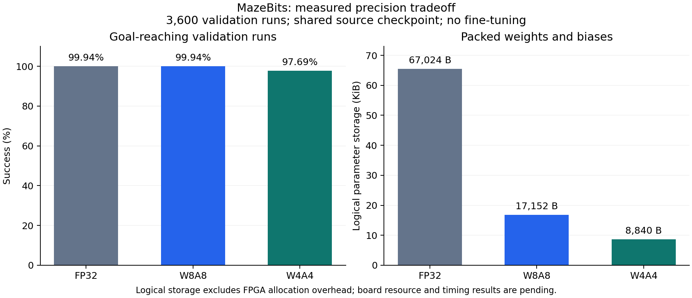

# Step 3: Integer CNNs for FPGA Inference

Step 3 converts the selected floating-point CNN into two implementations: W8A8 and W4A4. Both use the same Step 2 checkpoint and architecture. This is post-training quantization (PTQ): no weights were fine-tuned and no quantization-aware training was performed.

The result is an integer arithmetic contract, exported FPGA memory files, and a measured navigation comparison. RTL implementation and board timing/resource measurements belong to the next step.

## Measured comparison

All three versions use the same 22,029 validation states and 3,600 navigation scenarios from 150 layouts. The test partition remains reserved.

| Metric | FP32 | W8A8 | W4A4 |
|---|---:|---:|---:|
| Optimal-action decisions | 22,012 / 22,029 | 22,009 / 22,029 | 21,897 / 22,029 |
| Optimal-action accuracy | 99.9228% | 99.9092% | 99.4008% |
| Successful navigation | 3,598 / 3,600 | 3,598 / 3,600 | 3,517 / 3,600 |
| Navigation success rate | 99.9444% | 99.9444% | 97.6944% |
| Blocked / loop / timeout failures | 0 / 2 / 0 | 0 / 2 / 0 | 10 / 73 / 0 |
| Mean successful path / BFS optimum | 1.000279 | 1.000236 | 1.000725 |
| Logical packed parameter bytes | 67,024 | 17,152 | 8,840 |

W8A8 matches the floating-point success count; it does not produce identical decisions. It changes 222 state actions, for 98.9922% agreement with FP32. W4A4 changes 1,732, for 92.1376% agreement.

Agreement is different from accuracy. Several actions can be equally good shortest-path choices, so a different action can still be correct. Navigation success measures the complete sequence of decisions.

W4A4 loses 2.25 percentage points of navigation success relative to FP32/W8A8 and reduces logical parameter storage by 48.46% relative to W8A8. This makes the precision tradeoff visible without changing the model architecture or retraining either version.

These results describe the generated obstacle distribution. They do not establish reliability on every user-edited maze. Full measurements are in [comparison.json](../results/quantization/comparison.json).

## What uses 8 or 4 bits

| Quantity | W8A8 | W4A4 |
|---|---|---|
| Maze input | Exact binary 0 or 1 | Exact binary 0 or 1 |
| Weights | Signed -128 to 127 | Signed -8 to 7 |
| Hidden ReLU activations | Unsigned 0 to 255 | Unsigned 0 to 15 |
| Biases | Signed 32 bits | Signed 32 bits |
| Accumulators and final scores | Signed 32 bits | Signed 32 bits |
| Shift/rounding temporary | Signed 64 bits | Signed 64 bits |

The input still has three 8x8 planes: walls, agent, and goal. Its scale exponent is zero, so the integer codes already equal the real values. The first convolution pads walls with 1 and agent/goal planes with 0. Hidden feature-map padding remains 0.

Activations must be zero-extended before signed multiplication. Treating an unsigned 8-bit activation above 127 as signed would change its meaning.

## Representing real values with integer codes

Each tensor has a power-of-two exponent f:

~~~text
real value = integer code * 2^(-f)
integer code = round_away(real value * 2^f)
~~~

For example, code 12 with f=3 represents 1.5. Negative exponents are also valid: f=-3 means each code represents eight real units. This is used by the final W4A4 hidden layer.

Every layer has one weight exponent shared by its output channels. Each hidden layer also has one output-activation exponent. The final head shares one accumulator exponent across all four actions, so their raw integer scores can be compared directly.

## Calibration uses training data only

Calibration samples 4,096 distinct states from the 117,171 training states using seed 311. The sampled indices are sorted and recorded together with a SHA-256 of their little-endian int64 bytes.

The original FP32 model supplies its ReLU activations. For each weight tensor and hidden activation tensor, calibration:

1. Computes a max-fitting power-of-two exponent.
2. Tries nearby exponents from max-fit minus one through max-fit plus three, within [-16, 24].
3. Rounds and saturates to the candidate storage range.
4. Chooses the candidate with the lowest mean-squared reconstruction error.

Equal errors prefer fewer clipped codes, then the exponent closest to max-fit, then the smaller exponent. All-zero tensors select exponent zero.

The calibration report records every candidate, MSE, selected exponent, maximum, 99.9th percentile, and clipping count. This is a training-only scale-selection heuristic; it does not use validation navigation outcomes to choose the scales.

Calibration deliberately permits clipping when that improves reconstruction error. It clips two weight codes in W8A8 and 155 in W4A4. FP32 calibration activation clipping and saturation during propagated integer inference are different measurements; both are recorded.

The validation-state integer pass records 4,678 high activation saturations in W8A8 and 34,506 in W4A4. These are defined saturation operations, not accumulator overflow or wraparound. Per-layer counts and observed accumulator ranges are in the comparison report.

See [calibration.json](../results/quantization/calibration.json) for the complete audit.

## Exact layer arithmetic

Let f_in, f_w, and f_out be the input, weight, and hidden-output exponents:

~~~text
q_w = saturate_signed(round_away(weight * 2^f_w))
q_b = round_away(bias * 2^(f_in + f_w))

A = q_b + sum(q_input * q_w)
shift = f_in + f_w - f_out
q_output = saturate_unsigned(round_shift(A, shift))
~~~

Bias conversion must fit signed 32 bits; it is rejected if it overflows. Hidden output saturation clamps negative values to zero, implementing ReLU, and clamps high values to 255 or 15.

Rounding is nearest with halfway cases away from zero. For a positive right shift s:

~~~text
round_shift(A, s) = sign(A) * ((abs(A) + 2^(s-1)) >> s)
~~~

A shift of zero leaves the value unchanged. A negative shift multiplies by 2^(-s), equivalent to a left shift. The temporary is widened before taking an absolute value, adding the rounding offset, or shifting.

In particular, W8A8 conv0 has shift=-1. Its accumulator must be multiplied by two before unsigned saturation. A datapath that implements only right shifts would be incorrect.

The head has no ReLU or output requantization. Its four signed accumulator scores are read at the agent cell, and argmax selects UP=0, RIGHT=1, DOWN=2, or LEFT=3. Equal scores select the lowest action index. Scores from different precision modes use different exponents; dequantize them before comparing numerical score errors across modes.

## Exported scale table

The first layer has f_in=0. Each later layer inherits the preceding hidden output exponent. The head's output column below shows its raw accumulator exponent.

| Layer | W8 f_w | W8 output f | W8 shift | W4 f_w | W4 output f | W4 shift |
|---|---:|---:|---:|---:|---:|---:|
| conv0 | 6 | 7 | -1 | 3 | 3 | 0 |
| conv1 | 7 | 6 | 8 | 4 | 3 | 4 |
| conv2 | 7 | 5 | 8 | 4 | 2 | 5 |
| conv3 | 6 | 5 | 6 | 4 | 1 | 5 |
| conv4 | 7 | 3 | 9 | 4 | 0 | 5 |
| conv5 | 7 | 3 | 7 | 4 | -1 | 5 |
| conv6 | 7 | 2 | 8 | 4 | -2 | 5 |
| conv7 | 7 | 1 | 8 | 4 | -3 | 5 |
| head | 7 | raw 8 | none | 3 | raw 0 | none |

The manifests and generated Verilog headers are the authoritative constants. The header's head OUTPUT_FRAC describes the raw accumulator scale; HAS_RELU is zero.

## Why the accumulator cannot wrap

The export checks each output channel using its actual quantized weights and bias. Let U be the maximum legal input code: 1 for the first layer, otherwise 255 or 15.

~~~text
lower = q_bias + U * sum(min(q_weight, 0))
upper = q_bias + U * sum(max(q_weight, 0))
~~~

With the bias loaded first, every intermediate sum lies inside this interval, regardless of product order. The proof covers all allowed activation codes, rather than only activations observed during calibration or validation.

Across the exported channels and layers, W8A8 bounds lie within [-514,285, 461,141], and W4A4 bounds within [-3,690, 3,391]. Both fit signed 32 bits. Each manifest stores the per-channel proof; export rejects an unsafe model.

The vector reference uses NumPy int64 containers and checks signed32 results. An independent Python-integer scalar reference uses explicit nested convolution loops, checks every partial sum, and implements its own rounding and saturation.

## FPGA files and storage interpretation

The published bundles are [cnn-w8a8](../model/cnn-w8a8) and [cnn-w4a4](../model/cnn-w4a4). Each includes weights.mem, biases.mem, quantization.vh, and manifest.json.

Memory text uses one fixed-width hexadecimal word per line. Signed weights and biases use two's-complement bit patterns. Weights are flattened in output-channel, input-channel, kernel-row, kernel-column order, with layers concatenated in manifest order. The header contains offsets, sizes, exponents, shifts, and widths and is included inside a Verilog module.

Each model has 16,624 weights and 132 biases. Logical packed storage is therefore:

~~~text
W8A8: 16,624 weight bytes + 132 * 4 bias bytes = 17,152 bytes
W4A4:  8,312 weight bytes + 132 * 4 bias bytes =  8,840 bytes
~~~

This excludes headers, manifests, text-file overhead, activation buffers, and FPGA allocation granularity. It is not a measurement of BRAM blocks, DSP usage, clock frequency, or latency. Those comparisons require synthesized RTL.

## Reproduce and inspect

Use the Step 2 CPU environment and generated dataset. Output directories must be new or empty.

~~~powershell
python python/quantize.py --run-dir runs/quantization-ptq
python python/predict_fixed.py --bits 8 --maze detour --trace
python python/predict_fixed.py --bits 4 --maze detour --trace
python -m unittest discover -s python/tests -v
~~~

The quantization command writes fresh bundles under the selected run directory, reloads their memory files, and evaluates the reloaded integer networks. The model/ directories contain the published copies. It does not evaluate a floating-point fake-quantization approximation.

To regenerate and verify the eight reference cases for a precision:

~~~powershell
python python/export_fixed_vectors.py --model-dir model/cnn-w8a8 --output-dir test_vectors/cnn-w8a8 --training-metadata data/maze-v1/train.json
python python/verify_fixed_vectors.py --model-dir model/cnn-w8a8 --vectors-dir test_vectors/cnn-w8a8
~~~

Repeat with cnn-w4a4 for the four-bit bundle. The vectors are intended for future RTL comparisons of layer accumulators, hidden activations, action scores, and predictions.

For a fresh full-validation replay of both exported models:

~~~powershell
python python/verify_fixed_point.py --output-dir runs/recheck-fixed
~~~

Verification is complete: all 88 software tests passed. For each precision, memory-file replay matched 88,116 validation score words and all 3,600 navigation trajectories. Eight independent scalar cases matched 133,160 intermediate/output words per precision, with zero mismatches; all input and output memory-file hashes were verified.

The paired validation comparison has 3,517 scenarios where both modes succeed, 81 where only W8A8 succeeds, and two where both fail. The hand-written 21-move detour is an additional illustration: W8A8 succeeds in 21 moves; W4A4 hits a wall on attempt four. These observations were recorded after calibration and did not choose its scales.

See [verification.json](../results/quantization/verification.json), [vector_verification.json](../results/quantization/vector_verification.json), and [paired_comparison.json](../results/quantization/paired_comparison.json).

Step 4 will implement Verilog against this exact contract and compare its intermediate outputs with the exported reference vectors.

## Rebuild the figure

~~~powershell
python -m pip install -r requirements-plots.txt
python python/plot_quantization.py
~~~

