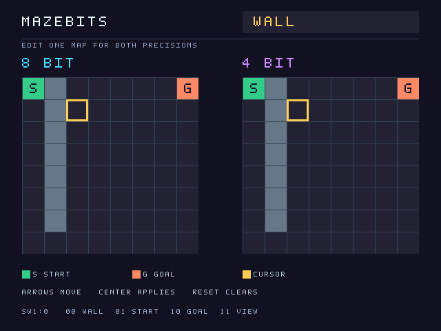

# Step 5: Maze editor and VGA display

Step 5 adds an editable 8x8 map, debounced board controls, and two mirrored VGA panels. The implementation passes simulation and routed FPGA checks. Physical programming and monitor checks remain to be performed. The neural engines are connected to navigation in Step 6.

This image is captured directly from the Verilog RGB outputs in simulation.

## Controls

| SW1:SW0 | Mode | Center button |
|---|---|---|
| 00 | WALL | Toggle the wall under the cursor |
| 01 | START | Place the start at the cursor |
| 10 | GOAL | Place the goal at the cursor |
| 11 | VIEW | Freeze editing; center and arrows are ignored |

Arrow buttons move the amber cursor one cell per press, stopping at the edges. Holding a button does not repeat. Both presses and releases must settle for 10 ms; the mode-switch bus also settles for 10 ms before being accepted. Set the mode first, then press center.

The center button takes priority if it is pressed simultaneously with an arrow. Simultaneous arrows have priority up, right, down, then left.

A wall cannot cover the start or goal. A rejected wall edit shows a message and lights LED9 for approximately half a second. Placing the start or goal on a wall clears that wall. Start and goal may share a cell, shown purple with a plus sign. The editor permits disconnected maps; it does not compute or guarantee a route.

CPU_RESETN restores an empty map, start at the upper left, goal at the lower right, and cursor at the upper left. Switch mode is accepted again after settling.

## Board test

The current working checkout is `X:\Desktop\EC_311\Project`. In Vivado, use **Open Project** to open the locally generated `runs/vivado/editor_gui/mazebits_editor.xpr` inside this checkout. It contains the four editor/VGA RTL files and `constraints/mazebits_editor.xdc`, with `mazebits_editor_top` selected for `xc7a100tcsg324-1`. Generated Vivado projects and bitstreams are local outputs, not tracked Git files.

Programming an existing bitstream only needs **Open Hardware Manager**; opening an RTL project is optional. The existing Python environment remains on `C:` and can run scripts from this checkout. On another computer, use `python` from your own environment.

From this checkout on the current computer:

~~~powershell
Set-Location 'X:\Desktop\EC_311\Project'
& 'C:\Users\t1sun\Documents\ChatGPT\EC311_Project\.venv\Scripts\python.exe' scripts/run_editor_vivado.py --stage bitstream --vivado C:/Xilinx/Vivado/2024.1/bin/vivado.bat
~~~

The generated bitstream is `runs/vivado/editor/mazebits_editor.bit`. Build scripts do not program the board.

1. Connect the board's programming USB port and VGA output; select the monitor's VGA input.
2. In Vivado Hardware Manager, open the target and select the XC7A100T device.
3. Choose **Program Device** and select `mazebits_editor.bit`.
4. Set SW1 and SW0 to zero and press CPU_RESETN.
5. Confirm the two grids, green S, coral G, amber cursor, and WALL heading.
6. Press right, then center: a wall should appear at row 0, column 1 in both panels.
7. Set SW1:SW0 to 01 and press center: S should move there and clear the wall.
8. Select 10 and place G; select 11 and confirm that arrows and center no longer edit the map.
9. Return to WALL and attempt to toggle an endpoint: the cell should remain free and the warning should appear.

Record the physical board and monitor test outcome separately.

## LED feedback

| LEDs | Meaning |
|---|---|
| 1:0 | Accepted mode, matching SW1:SW0 after debounce |
| 4:2 | Cursor column, binary 0 through 7 |
| 7:5 | Cursor row, binary 0 through 7 |
| 8 | Editing enabled; off in VIEW mode |
| 9 | Rejected wall edit |
| 10 | Map or endpoints modified since reset |
| 11 | Start and goal overlap |
| 14:12 | Off |
| 15 | Slow heartbeat derived from completed frame starts |

## How the map is stored and drawn

The maze uses 64 wall bits. Bit `row*8+column` describes one cell: 1 is a wall, 0 is free. Start, goal, and cursor each use a six-bit cell index. Button events update those registers; no laptop is needed to edit the map.

The VGA renderer computes a cell index from the current pixel coordinates, reads the corresponding wall bit, and chooses a color or glyph. There is no full-screen framebuffer. The synthesized design uses one 18 Kb block RAM for its small lookup logic and ordinary registers for the map and controls.

All logic stays on the board's 100 MHz clock. A four-phase enable pipeline updates pixels every fourth cycle, producing 640x480 visible pixels within an 800x525 raster. Both sync pulses are negative; blanking is black. The frame rate is 59.5238 Hz. This follows the 25 MHz / 60 +/- 1 Hz mode described in [Digilent's reference manual](https://digilent.com/reference/_media/reference/programmable-logic/nexys-4-ddr/nexys4ddr_rm.pdf).

Map, endpoint, cursor, mode, and warning registers are copied into the renderer together at the start of vertical blank. Edits therefore appear as complete frame updates. An edit on the snapshot edge can wait another frame. See [VGA layout and timing](vga-layout.md) for coordinates, palette, and pipeline details.

## Modules and constraints

| File | Responsibility |
|---|---|
| rtl/button_conditioner.v | Input synchronization and one pulse per debounced press |
| rtl/maze_editor.v | Cursor, wall, endpoint, and edit-rejection rules |
| rtl/maze_vga.v | Raster timing, frame snapshots, text, grid rendering, and registered output pins |
| rtl/mazebits_editor_top.v | Reset, mode settling, controls, feedback, and display connections |
| constraints/mazebits_editor.xdc | All 39 top-level pins, clock, voltage standards, and narrowly scoped timing exceptions |

The active pins match the archived user XDC. The Step 4 smoke-test top, constraints, CNN weights, and inference RTL remain available separately.

Reset uses synchronous sampling with FPGA initialization values. Only external input paths into the first synchronizer stage are excluded from timing. All internal register paths remain constrained to 10 ns; there are no multicycle or clock-group exceptions. VGA/LED outputs have no externally clocked receiving interface to which an output delay can be assigned.

## Verification

~~~powershell
& 'C:\Users\t1sun\Documents\ChatGPT\EC311_Project\.venv\Scripts\python.exe' scripts/run_editor.py --sim xsim --vivado-bin C:/Xilinx/Vivado/2024.1/bin
~~~

With Icarus Verilog on PATH:

~~~sh
python scripts/run_editor.py --sim iverilog
~~~

The runner needs only Python's standard library and saves per-test logs and source hashes under `runs/editor/`. It runs:

- 619 editor checks, including all 64 cells, edge clamping, priorities, overlap, and view-mode freezing.
- 14 button-conditioning checks covering bounce, release, simultaneous buttons, reset, and debounce thresholds.
- Integrated top checks for real input settling, wall/endpoint edits, reset, mode changes, and LED feedback.
- Three complete VGA frames: 1,260,000 pixel updates and 921,600 visible pixels. Checks cover every sync/blanking interval, raster order, pixel cadence, output stability, representative colors in both panels, frame snapshots, and reset.

All four suites pass Vivado XSim 2024.1. The 98 Python tests, including five new editor/VGA constraint audits, also pass. GitHub Actions runs the same HDL suites with Icarus.

## Routed implementation

| Metric | Editor/VGA build |
|---|---:|
| Target | XC7A100T-CSG324, speed grade -1 |
| Clock | 100 MHz |
| LUTs | 557 |
| Registers | 432 |
| BRAM | One RAMB18, or 0.5 of a 36 Kb tile |
| DSPs | 0 |
| Setup slack | +1.760 ns |
| Hold slack | +0.122 ns |
| DRC violations | 0 |

These counts are for the editor/display top alone. The final combined CNN/editor/VGA system requires a new build and new measurements. Full evidence is in [results/editor](../results/editor/README.md).

## Next milestone

Step 6 will connect both fixed-point CNNs to navigation controllers, snapshot one edited scenario for comparison, advance each agent independently, and show paths and outcomes. VIEW currently freezes editing; it does not start neural inference.
