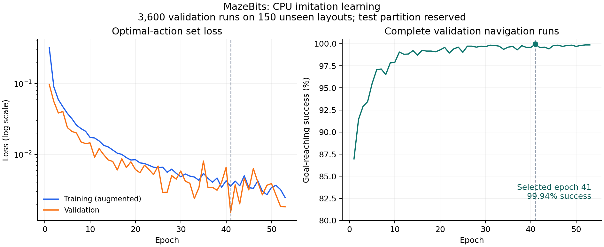

# Floating-point CNN baseline

Selected epoch 41 from a 53-epoch CPU run. The stopping rule and validation selection criterion were fixed before training. Test examples were not used for model selection or inference.

| Metric | Result |
|---|---:|
| Optimal-action accuracy | 22,012 / 22,029 (99.9228%) |
| Validation navigation success | 3,598 / 3,600 (99.9444%) |
| Failures | 2 loops; 0 blocked; 0 timeouts |
| Mean successful path / shortest path | 1.000279 |
| Successful shortest routes | 3,593 / 3,598 |
| Training time | 671.96 s, one CPU thread |

Both failures occur on one held-out wall layout and goal, with starting distances 14 and 18. The model enters a two-cell loop. Results describe the generated Bernoulli obstacle distribution and do not establish reliability on every editable maze.

## Evidence

- [metrics.json](metrics.json): selected checkpoint metrics and density groups.
- [history.csv](history.csv): every epoch, including unsuccessful checkpoint candidates.
- [run.json](run.json): training configuration, environment, dataset hash, and source snapshot.
- [validation_rollouts.json](validation_rollouts.json): all 3,600 action sequences and paths.
- [failures.json](failures.json): the two failures, including their wall layout.
- [verification.json](verification.json): fresh-process replay matched every trajectory and state metric.
- [example_checks.json](example_checks.json): post-training hand-written CLI checks.
- [training.svg](training.svg): vector training figure.

## Reproduce verification

~~~powershell
python python/prepare_data.py --output-dir data/maze-v1
python python/evaluate.py --data-dir data/maze-v1 --model-dir model/cnn-fp32 --output-dir runs/recheck-cnn --reference-rollouts results/cnn-baseline/validation_rollouts.json
~~~

Reuse the dataset if already generated. Output directories must be new or empty. The pinned CPU environment is described in run.json; floating-point replay can differ across platforms. The verifier records its loss tolerance and exact discrete/trajectory comparisons.

See [Step 2](../../docs/step-02.md) for the model and dataset details.
