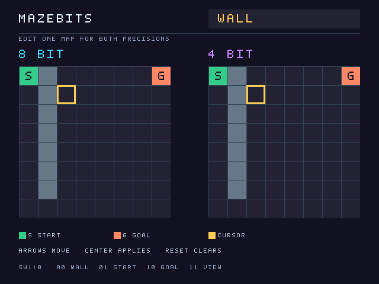

# Step 5 evidence

The editor, controls, VGA renderer, and integrated top pass Vivado XSim 2024.1. The routed editor/display build meets 100 MHz timing with no DRC violations. The bitstream has been generated locally; physical programming and monitor testing have not been performed.

[The edited frame](edited_frame.png) also demonstrates overlapping endpoints, a cursor on a wall, and protected-endpoint feedback. Both images are lossless conversions of RGB values written by the actual HDL testbench. They show the simulated output.

## Tests

| Suite | Recorded coverage |
|---|---|
| Editor | 619 checks; all 64 cells, boundaries, priorities, endpoint safety, overlap, and view freeze |
| Buttons | 14 checks; noise rejection, holds/releases, simultaneous inputs, reset, thresholds 1 and 4 |
| VGA | Three full frames, 1,260,000 pixel updates, 921,600 visible pixels; every timing/blanking interval and selected color locations |
| Integrated top | Input settling, mode bus, edits, reset, rejection, view mode, and status LEDs |

See [verification.json](verification.json) for source hashes and pass markers. Separate logs are [editor](editor_simulation.txt), [buttons](buttons_simulation.txt), [VGA](vga_simulation.txt), and [top](top_simulation.txt). The Python suite additionally passed 98 tests, including five new editor constraint audits.

## Implementation

| Metric | Result |
|---|---:|
| FPGA | xc7a100tcsg324-1 |
| Main clock | 100 MHz |
| Pixel enable rate | 25 MHz |
| Raster / visible area | 800x525 / 640x480 |
| Refresh | 59.5238 Hz |
| LUTs | 557 |
| Registers | 432 |
| RAMB18 blocks | 1 |
| DSP blocks | 0 |
| Setup / hold slack | +1.760 ns / +0.122 ns |
| DRC violations | 0 |

[implementation.json](implementation.json) records RTL, constraints, and build-script hashes, bitstream identity, and raw report hashes. The readable [timing report](timing_route.rpt), [utilization report](utilization_route.rpt), and [DRC report](drc_route.rpt) omit the workstation Host line and substitute any local repository path with `<repo>`; [published_report_hashes.json](published_report_hashes.json) identifies those published bytes.

These resources belong to the editor/VGA top alone, with no CNN instantiated. They must not be added blindly to the separately optimized Step 4 numbers to predict final combined resource use.

## Reproduction

Use the simulation and build commands in [Step 5](../../docs/step-05.md). The testbench writes `baseline_frame.ppm` and `edited_frame.ppm` under `runs/editor/vga/`. [frame_conversion.json](frame_conversion.json) records raw PPM and PNG hashes and their pixel equality. Pillow can convert regenerated captures to PNG without changing pixel values:

~~~sh
python -c "from PIL import Image; Image.open('runs/editor/vga/baseline_frame.ppm').save('runs/editor/vga/baseline_frame.png')"
~~~

Pillow is only needed for optional image conversion; simulation and implementation runners use standard-library Python. The image conversion was verified pixel for pixel. The reserved dataset partition and CNN weights are unchanged.
