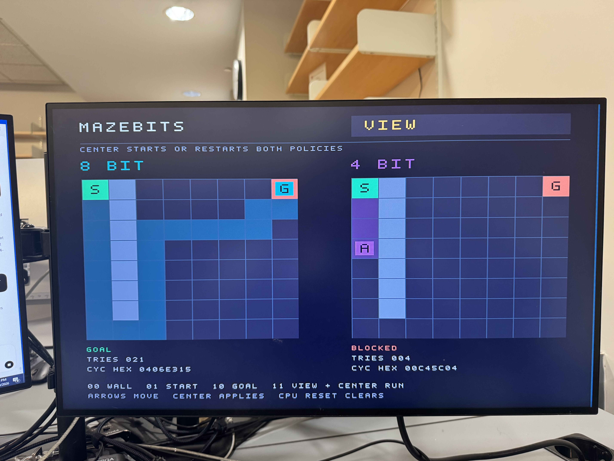
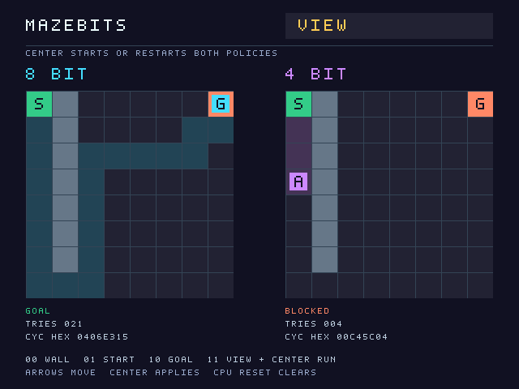
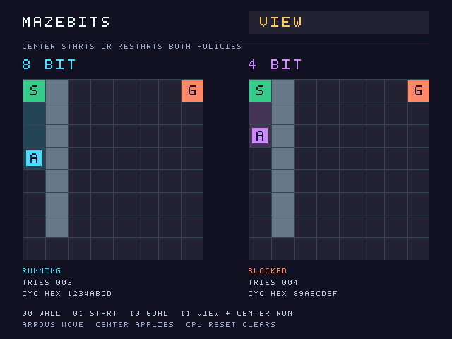

# Step 6 evidence

The final combined design passes the Python and XSim checks below and routes at 100 MHz with zero DRC violations. The user reported that Step 6 passes both the open-maze board test (GOAL / TRIES 014 on both panels) and the detour test (8-bit GOAL / TRIES 021, 4-bit BLOCKED / TRIES 004); [board-test.json](board-test.json) records that report and the remaining physical checks. The [Step 5 board-test report](../editor/board-test.json) records the user's successful earlier test separately.

## Physical board photographs

The supplied monitor photographs corroborate both reported outcomes. [The open-maze image](hardware/open-maze.jpg) shows both panels at GOAL / TRIES 014 / CYC HEX 02AF420E. The detour image above shows 8-bit GOAL / TRIES 021 / 0406E315 and 4-bit BLOCKED / TRIES 004 / 00C45C04. Each displayed cycle total equals the attempt count times 3,217,153, matching the reference; these are counter readouts, not an independent timing measurement.

[board-test.json](board-test.json) records the observed values and remaining physical checks. [hardware/photos.json](hardware/photos.json) records metadata removal and pixel equality. The primary JPEG scan data and color profile are preserved; the photographs were not cropped, resized, retouched, or recompressed.

## Simulation

| Suite | Verified coverage |
|---|---|
| Python | 107 tests, including frozen dual-model staging, vector integrity, and all 39 board pins |
| Navigation controller | 202 checks: bounds, walls, looping, completion priority, limits, snapshots, restart/reset, stale completion rejection, and pacing |
| Board controls | 34 checks: debounced input, independent agents, held-center behavior, restart, edit-mode cancellation, mode-exit display masking, overlap, and reset |
| VGA | Three complete frames, 1,260,000 pixel updates, 921,600 visible pixels, and 11,088 status/count/cycle text pixels |
| Real dual CNNs | Four scenarios/eight episodes, 60 decisions, 240 signed scores, all positions/trails/statuses/attempts/cycles, reset abort, busy restart, snapshots, and terminal holds |

[verification.json](verification.json) records final source hashes and the four XSim pass markers. Logs: [controller](controller_simulation.txt), [board controls](top_simulation.txt), [VGA](vga_simulation.txt), and [real CNNs](cnn_simulation.txt). [python-verification.json](python-verification.json) records the full Python test invocation. The [navigation vector manifest](../../test_vectors/navigation/manifest.json) binds all expected trajectories to the independent scalar oracle, integer reference, and frozen models.

Both engines elaborate together as physically distinct widths. Staging changes only the original core's module name and replaces its precision include with that model's checked constants. The numerical engine, exported weights, and reserved dataset partition are unchanged.

## Verified outcomes

| Scenario | W8A8 outcome / attempts | W4A4 outcome / attempts |
|---|---|---|
| Open | Goal / 14 | Goal / 14 |
| Detour | Goal / 21 | Blocked / 4 |
| Disconnected | Loop / 4 | Loop / 3 |
| Start at goal | Goal / 0 | Goal / 0 |

The controller stops at the first blocked action or repeated position, with no route repair. Each completed decision takes 3,217,153 inference cycles, or 32.17153 ms at 100 MHz, for either precision. A 200 ms animation pause is additional and excluded from the displayed CYC HEX total. TRIES counts attempted actions, including a blocked proposal.

## Combined implementation

| Metric | Final result |
|---|---:|
| Device | xc7a100tcsg324-1 |
| Clock | 100 MHz |
| LUTs | 2182 |
| Registers | 1694 |
| 36 Kb BRAM tile equivalents | 14.5 |
| RAMB36 / RAMB18 primitives | 12 / 5 |
| DSP blocks | 0 |
| Setup slack | +0.657 ns |
| Hold slack | +0.090 ns |
| DRC violations | 0 |

The hierarchy report for this same combined build assigns 656 LUTs and 8 RAMB36 + 2 RAMB18 blocks to the 8-bit engine, versus 516 LUTs and 4 RAMB36 + 2 RAMB18 blocks to the 4-bit engine. Cross-hierarchy optimization can merge shared logic; these are implementation observations, not architecture-independent resource guarantees.

[implementation.json](implementation.json) includes model/source/generated-file hashes and the bitstream identity. Readable reports: [timing](timing_route.rpt), [resources](utilization_route.rpt), [hierarchy](utilization_hierarchy.rpt), [DRC](drc_route.rpt), and [GUI compile order](gui_compile_order.rpt). Published reports omit the local Host line and replace the repository path with `<repo>`; [published_report_hashes.json](published_report_hashes.json) identifies their exact published bytes. Raw report hashes are recorded separately in the implementation JSON.

Bitstream: `mazebits_navigation.bit`, 3,825,908 bytes. SHA-256:

~~~text
e8645010991193704d6744bd7f47c98850310820ad267b655cdea2e4c269eff4
~~~

## Verified detour preview

This is a VGA rendering of verified reference final states, not a full-system CNN capture or board photograph. The renderer receives the final states from the scalar-checked detour vectors; the separate real-CNN test verifies that both engines produce those states. [preview.json](preview.json) records source and artifact hashes and pixel equality. Reproduce with `python scripts/render_navigation_demo.py`; it needs standard-library Python and XSim or Icarus.

## Renderer captures

[The second fixture](navigation_result.png) also exercises terminal statuses, occupied endpoint glyphs, and all three decimal counter digits. These are actual HDL RGB outputs for synthetic renderer fixtures, not complete CNN episode captures or photographs of a monitor. The 127-count fixture tests display formatting beyond the board's default 64-attempt episode limit. [frame_conversion.json](frame_conversion.json) verifies that PNG conversion preserved every pixel.

## Reproduce

Follow [Step 6](../../docs/step-06.md). Use `python scripts/run_navigation.py --sim xsim --vivado-bin C:/Xilinx/Vivado/2024.1/bin` or `--sim iverilog`. Build with `python scripts/run_navigation_vivado.py --stage bitstream --vivado C:/Xilinx/Vivado/2024.1/bin/vivado.bat`. These commands do not program the board.
