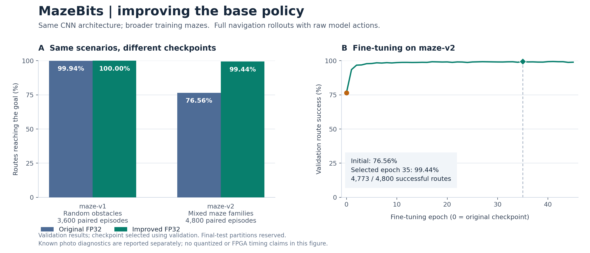

# Step 7: Measured policy improvement

The unchanged CNN was fine-tuned on structured obstacles and longer detours. It improves aggregate route success for FP32, W8A8, and W4A4 on both the original and expanded validation distributions. These are validation results; both reserved-test partitions remain unevaluated. The separately recorded [Step 8 hardware milestone](../../docs/step-08.md) integrates these weights into the FPGA.

## Same-distribution comparisons

v1 is the original random-obstacle validation set (150 layouts, 3,600 routes). v2 contains random obstacles, connected barriers/U-shaped obstacles, and winding corridors (200 layouts, 4,800 routes). Compare old and new values within a row. A score on v1 cannot be directly compared with a score on v2 to claim a model regression.

| Validation distribution | Precision | Original | Improved |
|---|---|---:|---:|
| v1 | FP32 | 3,598/3,600 (99.94%) | 3,600/3,600 (100.00%) |
| v1 | W8A8 | 3,598/3,600 (99.94%) | 3,600/3,600 (100.00%) |
| v1 | W4A4 | 3,517/3,600 (97.69%) | 3,557/3,600 (98.81%) |
| v2 | FP32 | 3,675/4,800 (76.56%) | 4,773/4,800 (99.44%) |
| v2 | W8A8 | 3,670/4,800 (76.46%) | 4,766/4,800 (99.29%) |
| v2 | W4A4 | 3,156/4,800 (65.75%) | 4,050/4,800 (84.38%) |

[summary.json](summary.json) binds the table to its sources. All policies use raw argmax with no BFS route repair or illegal-action masking. One-step accuracy and successful path efficiency are also recorded in the full evidence.

## Gains, remaining failures, and known photographs

On v1, FP32 gains two successful episodes and loses none. On v2, FP32 gains 1,101 and loses three; W8A8 gains 1,099 and loses three; W4A4 gains 1,021 and loses 127. Higher aggregate success does not mean every individual maze improves. Improved FP32 still loops on 27 of the 4,800 v2 routes; W8A8 loops on 34; W4A4 has 37 blocked moves and 713 loops.

For v2 routes requiring at least 20 BFS moves, FP32 improves from 34/479 to 464/479. All three known photographed mazes now succeed in FP32 at their shortest path lengths. The integer diagnostics are:

| Photograph | Shortest route | Improved W8A8 | Improved W4A4 |
|---|---:|---|---|
| IMG_7179 | 16 | GOAL / 16 | GOAL / 16 |
| IMG_7180 | 26 | GOAL / 26 | LOOP / 4 |
| Latest quantization-loop photograph | 14 | GOAL / 14 | GOAL / 16 |

These photographs are known development diagnostics, excluded from training/layout splits but not unbiased final tests. Original FP32 loops after six attempts on IMG_7179, while its old W8A8 version loops after five; the baseline replay preserves this distinction.

## Training and storage

[The dataset audit](../dataset-v2/README.md) records 1,200 training layouts and 163,128 labeled states, with routes up to 36 moves. All legacy layouts and known board demonstration layouts are excluded including rotations/reflections. The eight 3x3 convolution/ReLU layers, 16 channels, and 1x1 four-action head are unchanged: 16,756 parameters.

Fine-tuning uses seed 312, Adam at 0.0003, batch 256, D4 augmentation, and four CPU threads. Epoch 35 was selected from 45 epochs by v2 route success, then validation loss; total recorded training time is 342.14 seconds. The initial checkpoint remained eligible. Selection uses v2 validation; v1 validation is checked afterward for regressions.

Packed parameters remain 67,024 bytes FP32, 17,152 bytes W8A8, and 8,840 bytes W4A4. No parameter-count or logical-storage increase was needed. New integer exports use training-only calibration from 4,096 v2 states, seed 312. Actual new-weight FPGA resource usage and timing are recorded in the separate [Step 8 hardware evidence](../navigation-structured/README.md); the [benchmarking guide](../../docs/benchmarking.md) distinguishes the two checkpoints.

## Evidence and reproduction

- [FP32 comparison](comparison.json), [diagnostic traces](diagnostics.json), and all `dataset-*-rollouts.json` files: same-episode comparisons and complete paths.
- [Training metrics](metrics.json), [initial checkpoint metrics](initial_metrics.json), [history](history.csv), and [run provenance](run.json).
- [New-model quantization](quantization/comparison.json), [training-only calibration](quantization/calibration.json), and [scalar-checked integer diagnostics](quantization/diagnostics.json).
- [Old-versus-new quantized comparison on v2](cross-validation/original-on-v2/comparison.json); both cross-validation directories contain complete metrics, paths, predictions, and source/model/dataset hashes.
- [FP32 bundle](../../model/cnn-structured-fp32/README.md), [W8A8 bundle](../../model/cnn-structured-w8a8/README.md), and [W4A4 bundle](../../model/cnn-structured-w4a4/README.md).
- [Final local verification](verification.json): 128 Python tests pass, plus fresh-process replay of both published integer vector bundles.
- [W8A8 vectors](../../test_vectors/cnn-structured-w8a8/manifest.json) and [W4A4 vectors](../../test_vectors/cnn-structured-w4a4/manifest.json): eight cases and 133,160 intermediate words per precision match independent scalar loops. The three known maze traces add 92 decisions and 1,531,340 independently checked intermediate words, with zero mismatches.

Follow [Step 7](../../docs/step-07.md) to reproduce training, comparisons, calibration, and integer evaluation. The plot is reproduced by `python python/plot_policy_improvement.py --comparison-dir runs/comparison-structured-v2 --training-dir runs/cnn-structured-v2 --output-dir runs/policy-improvement-plot` (use a new output directory).

These artifacts record Step 7 software validation. [Step 8](../../docs/step-08.md) subsequently verifies the new bundles in RTL, rebuilds, and measures resources/timing. Its physical board observations are recorded separately and must not be inferred from software or HDL simulation.
