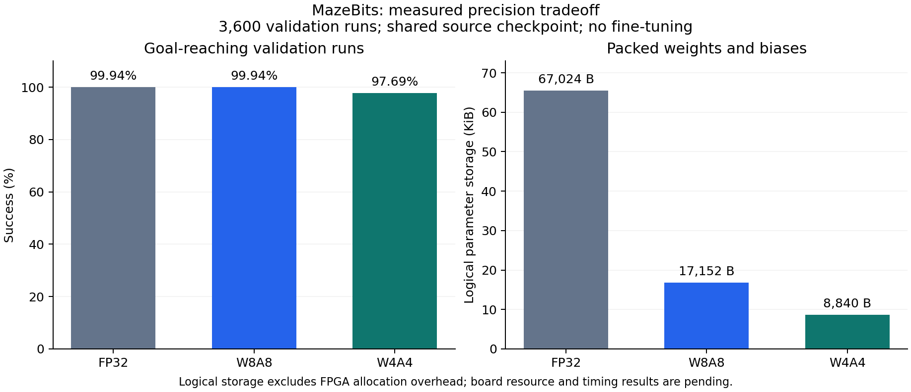

# Post-training precision comparison

Both integer variants use the unchanged Step 2 checkpoint. Calibration uses 4,096 training states and selects power-of-two scales by reconstruction MSE. No validation outcomes selected the scales, and no fine-tuning was performed.

| Metric | FP32 | W8A8 | W4A4 |
|---|---:|---:|---:|
| Optimal-action accuracy | 99.9228% | 99.9092% | 99.4008% |
| Goal-reaching runs | 3,598 / 3,600 | 3,598 / 3,600 | 3,517 / 3,600 |
| Navigation success | 99.9444% | 99.9444% | 97.6944% |
| Blocked / loop / timeout | 0 / 2 / 0 | 0 / 2 / 0 | 10 / 73 / 0 |
| Logical parameter bytes | 67,024 | 17,152 | 8,840 |

The W4A4 parameter payload is 48.46% smaller than W8A8, with a 2.25 percentage-point decrease in validation navigation success. The later [combined Step 6 implementation](../navigation/README.md) measures FPGA resources and inference cycles; the [benchmarking guide](../../docs/benchmarking.md) explains the comparison. The test partition remains reserved.

Both modes succeed in 3,517 paired scenarios; only W8A8 succeeds in 81; both fail in two. W8A8 and FP32 have the same success count but different action choices. Multiple shortest-path actions can all be correct.

## Evidence

- [comparison.json](comparison.json): all metrics, clipping statistics, scales/provenance identities, and output hashes.
- [calibration.json](calibration.json): sampled training indices and every scale candidate.
- [w8a8_rollouts.json](w8a8_rollouts.json), [w4a4_rollouts.json](w4a4_rollouts.json): all action sequences and paths.
- [paired_comparison.json](paired_comparison.json): differences on identical scenarios.
- [validation_predictions.npz](validation_predictions.npz): every saved integer score and FP32 action.
- [verification.json](verification.json): fresh-process match of 88,116 integer scores and 3,600 trajectories per precision.
- [vector_verification.json](vector_verification.json): 133,160 intermediate/output words per precision matched independent scalar loops.
- [example_checks.json](example_checks.json): W8A8 solves the 21-move detour; W4A4 blocks on attempt four.

The code uses defined saturation rather than arithmetic wraparound. All accumulator partial sums have an independent range proof.

## Reproduce

~~~powershell
python python/quantize.py --run-dir runs/my-quantization
python python/verify_fixed_point.py --output-dir runs/recheck-fixed
~~~

Use the Step 2 dataset and pinned CPU environment; output directories must be new or empty. Full replay verifies integer words and trajectories exactly, along with the recorded floating-point comparison metrics. Recalibrating the FP32 model or replaying floating-point comparisons can vary across platforms.

See [Step 3](../../docs/step-03.md) for the complete arithmetic contract and memory layout.
